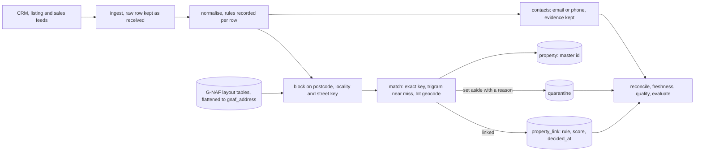

# parcelkey

Resolve messy property addresses into one master property id, with every decision on record.

[](https://github.com/Exalt24/parcelkey/actions/workflows/ci.yml)

parcelkey takes address and contact records from three feeds (a CRM export, a listing feed, a sales history), matches each address to a row in a table in the public G-NAF layout on PostgreSQL with PostGIS, and gives every property one stable id. It records the rule and the score behind every link, sets aside what it cannot decide with a reason, merges duplicate contacts only on a shared email or phone, and fences each agency's data off with forced row level security. All data in this repository is made up.

**@@TESTS@@ tests. @@MUTANTS@@ @@PRECISION_LINE@@** Measured @@DATE@@, commands and numbers below.

## What it is and why

A property data team gets the same house from many places. One feed writes `Unit 5, 12 Smith St`, another `5/12 Smith Street`, a third `Apt 5 12 SMITH ST.`, and a fourth leaves the postcode out. In a tower, two records that differ only by the unit are two homes, and merging them is the worst mistake available. A lot with no street number may or may not be the same place as a numbered address on the same road. A contact can show up three times with a nickname, a capital letter in the email and a phone number written three ways.

parcelkey is a small pipeline that does this work and keeps the evidence. It normalises each record and writes down which rules fired. It narrows the search with blocking so it scales. It matches on the exact key first, then on a typo tolerant street name with a threshold and a tie rule, and it has two hard rules that no setting turns off: a different unit never matches, and a lot only address never merges with a numbered one unless a geocode is within a distance. A record it cannot decide goes to quarantine with a reason code instead of a guess. A reconcile command proves that every source row is linked or set aside, that nothing is orphaned and that no property has two ids.

The data is generated. `scripts/seed.py` writes about 4,200 addresses in the G-NAF table layout across five states, and two agencies' feeds that refer to them with realistic defects, plus a hidden answer key that only `parcelkey evaluate` reads. What was checked against Geoscape's published documents, and what was not, is in [docs/data-sources.md](docs/data-sources.md).

## How it works



| Stage | What it does | Where |
|---|---|---|
| Load G-NAF | Reads pipe delimited files named the way Geoscape's guide shows (`NSW_ADDRESS_DETAIL_psv.psv`), matching columns by header name, then flattens address, street, locality, state and geocode into `gnaf_address` with the same normalised parts a record gets. | `parcelkey/gnaf.py` |
| Ingest | Stores each feed row as received. A feed with a missing column is refused whole. Rows without a reference, with a blank address, repeated, or changed after loading go to `ingest_reject` with a reason. The same bytes loaded again write nothing. | `parcelkey/ingest.py` |
| Normalise | Unit forms (`Unit 5,`, `5/12`, `Apt 5 12`, `U5/12`, `Flat 5`, `Level 3 Suite 7`), street types, Mount and Saint, case and punctuation, state names, lots, building names, phones to E.164, emails lower cased. The ids of the rules that fired are stored on the row. | `parcelkey/normalise.py`, [docs/normalisation.md](docs/normalisation.md) |
| Block | Candidate generation in SQL on postcode and street key, locality and street key, and a trigram index for near misses, so a record is only compared with its own street. | `parcelkey/block.py` |
| Match | Exact canonical key first. Then pg_trgm similarity with a configurable threshold and a tie margin. Lots by PostGIS `ST_Distance` on `geography`. A different unit never matches. | `parcelkey/match.py`, [docs/matching.md](docs/matching.md) |
| Master id | `pk_g_` plus a hash of the G-NAF address pid when matched, else `pk_d_` plus a hash of the canonical key. Derived, never numbered, never reassigned by a rerun. | `parcelkey/master.py` |
| Link table | One row per decided record: property, rule, score, `decided_at`, and every rule that fired. | `property_link` |
| Quarantine | Ties, below threshold, conflicting unit evidence, a lot with no geocode or too far, a transposed street number, an unreadable address, each with a reason code and the candidates. A later run can free a record when the reference changes. | `quarantine` |
| Contacts | Two mentions merge only on a shared normalised email or E.164 phone inside one agency, with the evidence recorded. Never on a name. A crowd on one number is set aside. | `parcelkey/contacts.py` |
| Permissions | `agency_id` in every key of every agency table and forced row level security, with a non owner role that cannot read another agency's links or contacts. | `parcelkey/migrations/003_rls.sql`, `parcelkey/db.py` |
| Reconcile | Re-reads the feed files with its own small reader and checks the database from its own side: file rows equal stored plus rejected plus unchanged, every record linked or quarantined, no orphan, one id per property, every contact mention resolved. Exit 1 on any finding. | `parcelkey/reconcile.py` |
| Freshness | Each source's last load against a configured maximum age. Exit 1 when stale or missing. | `parcelkey/freshness.py` |
| Data quality | What the feeds looked like, what normalisation repaired, what the match stage did. | `parcelkey/quality.py` |
| Evaluate | Precision and recall against the hidden answer key, with a table by defect class. | `parcelkey/evaluate.py` |

## Measured results

@@RESULTS@@

## Run it

You need Python 3.11 or newer and Docker. PostgreSQL 16 with PostGIS runs in a container on port 5436. No accounts, keys or downloads.

```
python -m venv .venv
.venv/Scripts/activate        # Windows; on Linux and macOS: source .venv/bin/activate
pip install -r requirements.txt
python tools/pg.py up && python -m parcelkey init-db
python scripts/seed.py --out out/seed --seed 7
python -m parcelkey load-gnaf out/seed/gnaf
python -m parcelkey run --agency agency-a --feeds out/seed/agency-a
python -m parcelkey reconcile --agency agency-a --feeds out/seed/agency-a
python -m parcelkey evaluate --agency agency-a --key out/seed/answer_key.csv --truth out/seed/truth_properties.csv
```

Other commands: `quality`, `freshness --agency agency-a --max-age crm=168`, `quarantine --agency agency-a --reason UNIT_CONFLICT`, and `explain --agency agency-a crm:C00042`, which prints one record's raw row, its normalised parts, the rules that fired and what was decided. `python tools/measure.py --seed-dir out/seed` runs both agencies and prints the measurement; `--sweep 0.5,0.6,0.7` runs it once per similarity threshold. `python tools/pg.py down` removes the container.

## Tests

```
python tools/pg.py up        # the tests need the container; a missing database fails them, it never skips them
python -m pytest             # @@TESTS@@ tests, about two minutes
python tests/mutation_check.py --module normalise     # one module at a time; --guards runs the named guards; --summary totals them
```

What the suites cover, the Hypothesis properties, the planted bugs and how the mutation check works are in [docs/tests.md](docs/tests.md). The mutation results are in [docs/mutation-results.txt](docs/mutation-results.txt). CI runs the suite against a PostGIS service container.

## What was hard

@@HARD@@

## Limits

- The data is made up. The addresses are in the public G-NAF table layout and are not G-NAF. Suburb and street names are built from syllables, people are common given names with invented surnames, emails are on `example.com`, phones are landline numbers in the 5550 range ACMA reserves for fiction.
- The loader for the real pipe delimited G-NAF files was only run on files that `scripts/seed.py` wrote in the same layout. It has not read a real Geoscape release. File names, the pipe delimiter and the header row come from Geoscape's unpacking guide. Column types come from the Data Product Description. Real files may differ in ways those pages do not say. Loading 15 million rows through the Python flattening step has not been tried.
- Eight of the tables in a real release are modelled (ADDRESS_DETAIL, ADDRESS_DEFAULT_GEOCODE, STREET_LOCALITY, LOCALITY, STATE and three lookup tables). ADDRESS_ALIAS, ADDRESS_SITE, mesh blocks, street suffixes and the other tables are skipped and reported. An address with no street is left out of the flat reference.
- English style addresses only. No other language, no PO boxes, no rural or intersection addresses, no street suffix such as `NORTH`, no suburb typos (the suburb must agree exactly), no postcode inference.
- No licensed property data is used or imitated: nothing from CoreLogic, Domain, REA or Pricefinder.
- A near miss street name is a similarity score, not knowledge. Two real streets that differ by one letter can pull a record the wrong way, and a new address whose street name is close to an existing one can be merged into it; both show up in the measured wrong links.
- A street number that is a digit swap of a neighbour's is set aside as NUMBER_TRANSPOSED, which also sets aside a genuine new address with such a number.
- A contact phone shared by two real people merges them. The cap on cluster size limits the damage and does not remove it. Two mentions of one person with no shared email or phone stay two contacts, by design.
- A record that changes after it was loaded is rejected as CHANGED_AFTER_LOAD, not applied. A feed delivered again with identical bytes does not refresh its age in the freshness monitor.
- The master property list is shared by every agency and holds addresses only. An agency's own address that is not in G-NAF becomes a bare derived property row that other agencies can read. Everything that says who holds a record is agency scoped.
- Nothing is deployed. One machine, one database, no TLS, no job scheduler, no web app.

## Stack

Python 3.11 or newer, PostgreSQL 16 with PostGIS 3.4 and pg_trgm, psycopg 3, pytest, Hypothesis, plain SQL migrations and Docker. Developed on 3.13.

## License

MIT, see [LICENSE](LICENSE).
