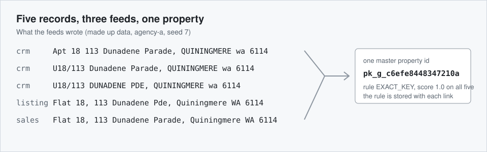

# parcelkey



Resolve messy property addresses into one master property id, with every decision on record.

[](https://github.com/Exalt24/parcelkey/actions/workflows/ci.yml)

**On 4,904 made-up records parcelkey made 4,547 links and 4,529 were right: precision 99.60%, and recall 98.93% of the 4,578 records that should link, with no merge of two different units. Counting the 326 records its own policy sets aside as misses, honest recall is 92.35%.** The suite has 915 tests. The recorded mutation check changed one guard at a time in 1,772 places (1,732 from the syntax tree of 13 modules, 40 named guards) and a test failed every time, on the final code after the fifth review's fixes; the run was reduced (15 Hypothesis examples per test instead of 60, and only the tests that cover the mutated module). Measured 2026-11-11, numbers and commands below.

Two limits belong next to those figures. A flat that G-NAF does not list is never matched to a neighbouring unit: it stays in quarantine as UNIT_CONFLICT and has no master id until a later release lists it, because the matcher never lets a different unit match; 163 of the 4,904 records (3.3 percent) are set aside this way. And agencies are kept apart for each agency's own rows only: a derived id shows every agency its display address and the point of the first record that made it.

parcelkey takes address and contact records from three feeds (a CRM export, a listing feed, a sales history), matches each address to a row in a table in the public G-NAF layout on PostgreSQL with PostGIS, and gives every property one id that is stable for one G-NAF release file. It records the rule and the score behind every link, sets aside what it cannot decide with a reason, merges duplicate contacts only on a shared email or mobile number, and keeps each agency's own rows apart with forced row level security. The caller names the agency and one database role serves all of them. The master property list is shared: a property made for an address that is not in G-NAF (a derived id) shows every agency the display address and the point of the first record that made it. All data in this repository is made up.

## What it is and why

A property data team gets the same house from many places. One feed writes `Unit 5, 12 Smith St`, another `5/12 Smith Street`, a third `Apt 5 12 SMITH ST.`, and a fourth leaves the postcode out. In a tower, two records that differ only by the unit are two homes, and merging them is the worst mistake available. A lot with no street number may or may not be the same place as a numbered address on the same road. A contact can turn up three times with a nickname, a capital letter in the email and a phone number written three ways.

parcelkey normalises each record and writes down which rules fired. It narrows the search with blocking. It matches on the exact key first, then on a typo tolerant street name with a threshold and a tie rule. Two hard rules cannot be switched off: a different unit never matches, and a lot only address never merges with a numbered one unless a geocode is within a distance. A record it cannot decide goes to quarantine with a reason code. A reconcile command proves that every source row is linked or set aside, that nothing is orphaned and that no property has two ids.

The data is generated. `scripts/seed.py` writes about 4,200 addresses in the G-NAF table layout across five states, two agencies' feeds that refer to them with realistic defects, and a hidden answer key that only `parcelkey evaluate` reads. What was checked against Geoscape's published documents, and what was not, is in [docs/data-sources.md](docs/data-sources.md). What the answer key is, and what the accuracy figures cannot show, is in [docs/results.md](docs/results.md).

## How it works


| Stage | What it does | Where |
|---|---|---|
| Load G-NAF | Reads pipe delimited files named as Geoscape's guide shows (`NSW_ADDRESS_DETAIL_psv.psv`), columns by header name, and flattens them into `gnaf_address`. An alias address becomes one more spelling of its principal, never a property. A reload upserts by key: new, changed and newly retired rows are counted, and the master list's copy of each address is refreshed. | `parcelkey/gnaf.py` |
| Ingest | Stores each feed row as received, read by the one reader `reconcile` also uses. A feed missing a column is refused whole and reported while the other feeds still run. Bad rows, among them a row with more cells than the header, go to `ingest_reject` with a reason. The same bytes again write nothing, and a file that stores nothing does not move the feed's age. An agency id that was never loaded is refused unless `run` gets `--new-agency`. | `parcelkey/ingest.py` |
| Normalise | Unit forms (prefixes, zeros, floor words), all 275 G-NAF street types and street suffixes, Mount and Saint, case and punctuation, state names, lots, building names, phones to E.164, emails lower cased. A PO Box, GPO Box, Locked Bag or Private Bag is marked as a mailbox. A carspace is kept apart from a unit and a basement from a level. The rule ids are stored on the row. | `parcelkey/normalise.py`, [docs/normalisation.md](docs/normalisation.md) |
| Block | Candidates in SQL on postcode and street key, locality and street key, and a trigram index for near misses. | `parcelkey/block.py` |
| Match | Exact key, then pg_trgm similarity with a threshold and a tie margin, lots by `ST_Distance` on `geography`. A different unit never matches. | `parcelkey/match.py`, [docs/matching.md](docs/matching.md) |
| Master id | `pk_g_` plus a hash of the G-NAF pid, else `pk_d_` plus a hash of the canonical key. Derived, never numbered, never reassigned, stable for one release file. A new address written with and without a street suffix is one derived property. | `parcelkey/master.py` |
| Quarantine | Ties, below threshold, unit conflict, lot with no geocode or too far, transposed number, unreadable address, mailbox, no suburb, each with a reason code and the candidates. A later run can free a record. | `quarantine` |
| Contacts | Merge only on a shared normalised email or E.164 mobile number inside one agency, evidence kept. A landline never merges. Never on a name. A crowd on one number is set aside, and decided again when the cap is raised. | `parcelkey/contacts.py` |
| Permissions | `agency_id` in every key and forced row level security, with a non owner role. | `parcelkey/migrations/003_rls.sql` |
| Reconcile | Re-reads the feed files with the loader's reader. Rows equal stored plus rejected plus unchanged, every stored reference holds what the file says, every record linked or quarantined, no orphan, one id per property. A derived property that a later release now covers is listed as SUPERSEDED and never rewritten. Exit 1 on any finding. | `parcelkey/reconcile.py` |
| Freshness, quality, evaluate | Last load that stored a row against a maximum age (exit 1 when stale, missing, or when the latest file was all rejected). What the feeds looked like. Precision, recall and honest recall against the answer key. | `freshness.py`, `quality.py`, `evaluate.py` |

## Measured results

All from my runs on 2026-11-11 (Windows 11, 16 logical cores, PostgreSQL 16 with PostGIS 3.4 in Docker on the same machine, other containers running, and another heavy job was using the machine during the final run, so its timings are inflated and say nothing about speed; the counts and percentages do not depend on timing). Full tables: [docs/results.md](docs/results.md). Raw output: [docs/measured-run.txt](docs/measured-run.txt).

| What | Result | How |
|---|---|---|
| Generated world | 4,230 addresses in the G-NAF layout (5 states, 37 localities, 226 streets) plus 92 new addresses made that are not in the file, 72 of which the feeds use; 4,904 source rows in two agencies (each 981 CRM, 662 listing, 809 sales) | `python scripts/seed.py --out out/seed --seed 7` |
| G-NAF load | 9,135 rows in 3.00 s, flat reference of 4,230 addresses in 0.58 s | `python -m parcelkey load-gnaf out/seed/gnaf` |
| Links | 4,547 made, 4,529 right: **precision 99.60%**. Of 4,578 records that should link, 4,529 did: **recall 98.93%**. Counting the 326 records the matcher's own policy sets aside as misses: **honest recall 92.35%** (4,529 of 4,904) | `python tools/measure.py --seed-dir out/seed` |
| Set aside | 357 in quarantine: 324 where the answer key says that is right, 33 that could have linked | same |
| Wrong links | 18, of which 16 are new addresses (not_in_gnaf) merged into a street one letter different | same |
| Different units merged | 0 | same |
| Contacts | 3,338 mentions became 2,493 contacts: pair precision 100.00%, pair recall 68.34%. Only an email or a mobile number merges, and the generator writes landline phones only, so no generated phone merges anyone; before the fifth review a shared landline merged contacts and recall read 93.99%. The generator never makes two people share an email or phone, so the 100.00% holds by construction and shows no real world rate | same |
| One agency, 2,452 records | ingest 21.9 s, normalise 7.0 s, match 56.7 s, contacts 24.6 s | same |
| Ten times the data | precision 99.91%, recall 99.23%, honest recall 92.95%; one agency of 23,370 records matched in 386 s (the other in 391 s) | [docs/results.md](docs/results.md) |

Which defect classes were resolved, set aside or missed is in [docs/results.md](docs/results.md).

## Run it

You need Python 3.11 or newer and Docker. PostgreSQL 16 with PostGIS runs in a container on port 5436, published on 127.0.0.1 only, with three databases that never share data: `parcelkey` is the demo database that every `python -m parcelkey` command below fills, `parcelkey_test` is the one `python -m pytest` empties and refills, and `parcelkey_measure` is the one `tools/measure.py` empties and refills. The tests and the measure script refuse to run against `parcelkey`, so running them does not wipe what you just loaded. There are no accounts or keys. The first `python tools/pg.py up` pulls the `postgis/postgis:16-3.4` image, which takes a few minutes on a slow link, and `pip install` fetches three packages.

```
python -m venv .venv
.venv/Scripts/activate        # Windows; on Linux and macOS: source .venv/bin/activate
pip install -r requirements.txt
python tools/pg.py up && python -m parcelkey init-db
python scripts/seed.py --out out/seed --seed 7
python -m parcelkey load-gnaf out/seed/gnaf
python -m parcelkey run --agency agency-a --feeds out/seed/agency-a --new-agency
python -m parcelkey reconcile --agency agency-a --feeds out/seed/agency-a
python -m parcelkey evaluate --agency agency-a --key out/seed/answer_key.csv --truth out/seed/truth_properties.csv
```

Also `quality`, `freshness --agency agency-a --max-age crm=168`, `quarantine --agency agency-a --reason UNIT_CONFLICT`, and `explain --agency agency-a crm:C00042`, which prints one record's raw row, its normalised parts, the rules that fired and what was decided. `python tools/measure.py --seed-dir out/seed` runs both agencies in `parcelkey_measure`, not in the demo database; `--sweep 0.5,0.6,0.7` runs once per similarity threshold. A second agency is started the same way, for example `python -m parcelkey run --agency agency-b --feeds out/seed/agency-b --new-agency`; an agency id that was never loaded is refused without `--new-agency`, so a typo cannot start one. `python tools/pg.py down` removes the container.

## Tests

```
python tools/pg.py up        # a missing database fails the tests, it never skips them
python -m pytest             # 915 tests, in the database parcelkey_test, never the demo one
python tests/mutation_check.py --module normalise     # one module at a time; --guards runs the named guards; --summary totals them
```

What the suites cover, the planted bugs and how the mutation check works are in [docs/tests.md](docs/tests.md). The mutation results are in [docs/mutation-results.txt](docs/mutation-results.txt). The CI workflow runs the whole suite against a PostGIS service container on Ubuntu, and its first run on GitHub was green. The figures in this README come from runs on one Windows 11 machine with Python 3.13.

## What was hard

- **A first measurement that was too good.** The first run gave 100.00% precision at every threshold, because the generated street names were far apart and a typo never had a rival. I added look-alike streets in one suburb (Harwick Street beside Hardwick Street) and addresses missing from the file. Precision fell to the numbers above and showed the real failure: a new address whose street is one letter from an existing street gets merged into that street's number. No threshold below 0.80 fixes it.

The other seven, among them a wider street type list that broke ordinary suburbs and a suffix that made a coin flip, are in [docs/what-was-hard.md](docs/what-was-hard.md).

## Limits

- The data is made up. The addresses are in the public G-NAF table layout and are not G-NAF. Names are built from syllables and common given names, emails are on `example.com`, phones are landline numbers in the 5550 range ACMA reserves for fiction, so no generated phone number merges contacts.
- The loader for real G-NAF files was only run on files that `scripts/seed.py` wrote in the same layout. It has not read a real Geoscape release. File names, the pipe delimiter and the header row come from Geoscape's unpacking guide, column types from the Data Product Description. Real files may differ in ways those pages do not say.
- Ten tables of a real release are modelled: STATE, LOCALITY, STREET_LOCALITY, ADDRESS_DETAIL, ADDRESS_ALIAS, PRIMARY_SECONDARY, ADDRESS_DEFAULT_GEOCODE and the three authority code tables. ADDRESS_SITE, ADDRESS_FEATURE, mesh blocks and the rest are skipped and reported. An address with no street is left out of the flat reference. PRIMARY_SECONDARY is loaded and the matcher does not use it.
- There are no parcels. `legal_parcel_id` is loaded from ADDRESS_DETAIL and nothing reads it: no parcel boundaries, no cadastre, and no roll up from addresses to parcels.
- How match time grows with the record count is not settled: in the final run, which shared the machine with another heavy job, ten times the records took 5.8 to 6.8 times as long to match, and an earlier run on a quiet machine read a larger factor (see the ten times run). Nothing near the real file's 15 million addresses has been tried.
- English style addresses only. A PO Box, GPO Box, Locked Bag or Private Bag is set aside as POSTAL_ADDRESS, also when a street comes with it. Other mailbox forms are not recognised: Post Office Box written out, Private Mail Bag, CMB and Roadside Mailbox have no street and are set aside as UNPARSEABLE, while `RMB 5 Smith Rd` and `Parcel Locker 12 Smith St` are read as that street address. Rural and intersection addresses have no street number and are set aside as unparseable. A street suffix is read only straight after a street type, and with no comma and no suburb field it is read as part of the suburb. There are no suburb typos (the suburb must agree exactly), so a misspelt suburb written with no postcode mints a second derived id for an address G-NAF lists, and with its postcode it is set aside as LOCALITY_CONFLICT; and there is no postcode inference; only an NT postcode gets its lost zero back. A postcode fills a blank state only in a derived property's key. `4 A St Ingowick Street` is number 4A, so `5 O Connell Street` is read as 5O.
- A flat that G-NAF does not list stays in quarantine as UNIT_CONFLICT with no master id until a later release lists it, whatever the feeds say: the unit rule cannot be switched off, and a new or unlisted flat is the price of it (the unit_unknown and tower_no_unit_noparent classes in [docs/results.md](docs/results.md)).
- Only 15 of G-NAF's 53 flat types are kept apart from a unit (a carspace, a garage and the like). `Shop 3` and `Unit 3` in one building read as one unit. `L3/12` is read as level 3 of number 12, where it could be a flat called L3.
- No licensed property data is used or imitated: nothing from CoreLogic, Domain, REA or Pricefinder.
- A lot only record with a point near a numbered address that carries the same lot links to that address by LOT_GEOCODE even when it is a flat, because the lot belongs to the building.
- A near miss street name is a similarity score, not knowledge. A new address whose street is close to an existing one can merge into it, and a genuine new address whose number is a digit swap of a neighbour's is set aside. Both show in the measured misses and wrong links.
- Only a shared email or mobile number merges contacts. A landline never merges anyone, so a person who gives only a landline is a new contact every time; a mobile shared by two real people merges them, and the cluster cap limits the damage. Two mentions of one person with no shared email or mobile stay two contacts, by design.
- A record that changes after loading is rejected as CHANGED_AFTER_LOAD, not applied. `reconcile --feeds` reports it as FILE_NOT_APPLIED and `freshness` counts the rejected rows, and none of these moves the feed's age: the same bytes again, a file whose rows are all unchanged and a file whose rows are all rejected leave it as it was.
- `freshness` expects all three feeds. An agency that sends fewer sees the missing ones as MISSING and exit 1; `--max-age` changes a limit and cannot drop a source.
- The master property list is shared by every agency and holds addresses only. An agency's own address that is not in G-NAF becomes a derived row other agencies can read, with the display address and the point of the first record that made it. Everything that says who holds a record is agency scoped. The caller names the agency for each transaction and one database role serves every agency, so row level security keeps a transaction to the agency it named and does not stop a caller that names another.
- A new address written with and without a street suffix links to one derived property, and the first form seen names its id, so which key a property carries depends on which feed arrived first.
- A G-NAF reload is an upsert: a changed column and a new retired date are written and counted, a pid the new file leaves out stays, and properties already made for a pid the release has since retired are counted and left as they are, nothing merged or rewritten.
- A derived id stays derived after its address reaches G-NAF. `reconcile` lists those properties as SUPERSEDED and a person decides what to merge. The G-NAF id hashes ADDRESS_DETAIL_PID, and ADDRESS_FEATURE, which tracks a pid across releases, is not modelled, so a re-issued pid gives a new id.
- Nothing is deployed. One machine, one database, no TLS, no scheduler, no web app.

## Stack

Python 3.11 or newer (developed on 3.13), PostgreSQL 16 with PostGIS 3.4 and pg_trgm, psycopg 3, pytest, Hypothesis, plain SQL migrations and Docker.

## License

MIT, see [LICENSE](LICENSE).
