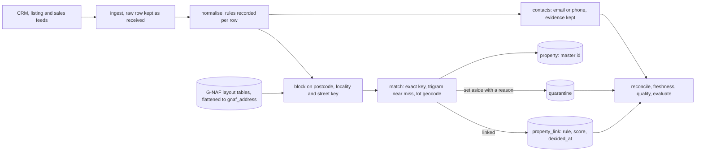

# parcelkey

Resolve messy property addresses into one master property id, with every decision on record.

[](https://github.com/Exalt24/parcelkey/actions/workflows/ci.yml)

parcelkey takes address and contact records from three feeds (a CRM export, a listing feed, a sales history), matches each address to a row in a table in the public G-NAF layout on PostgreSQL with PostGIS, and gives every property one stable id. It records the rule and the score behind every link, sets aside what it cannot decide with a reason, merges duplicate contacts only on a shared email or phone, and fences each agency's data off with forced row level security. All data in this repository is made up.

**513 tests. All 1,110 mutants killed (1,071 from the syntax tree of 13 modules and 39 named guards). On 4,904 made-up records: precision 99.60%, recall 98.93%, no merge of two different units.** Measured 2026-11-10, numbers and commands below.

## What it is and why

A property data team gets the same house from many places. One feed writes `Unit 5, 12 Smith St`, another `5/12 Smith Street`, a third `Apt 5 12 SMITH ST.`, and a fourth leaves the postcode out. In a tower, two records that differ only by the unit are two homes, and merging them is the worst mistake available. A lot with no street number may or may not be the same place as a numbered address on the same road. A contact can turn up three times with a nickname, a capital letter in the email and a phone number written three ways.

parcelkey normalises each record and writes down which rules fired. It narrows the search with blocking. It matches on the exact key first, then on a typo tolerant street name with a threshold and a tie rule. Two hard rules cannot be switched off: a different unit never matches, and a lot only address never merges with a numbered one unless a geocode is within a distance. A record it cannot decide goes to quarantine with a reason code. A reconcile command proves that every source row is linked or set aside, that nothing is orphaned and that no property has two ids.

The data is generated. `scripts/seed.py` writes about 4,200 addresses in the G-NAF table layout across five states, two agencies' feeds that refer to them with realistic defects, and a hidden answer key that only `parcelkey evaluate` reads. What was checked against Geoscape's published documents, and what was not, is in [docs/data-sources.md](docs/data-sources.md).

## How it works



| Stage | What it does | Where |
|---|---|---|
| Load G-NAF | Reads pipe delimited files named as Geoscape's guide shows (`NSW_ADDRESS_DETAIL_psv.psv`), columns by header name, and flattens them into `gnaf_address`. | `parcelkey/gnaf.py` |
| Ingest | Stores each feed row as received. A feed missing a column is refused whole. Bad rows go to `ingest_reject` with a reason. The same bytes again write nothing. | `parcelkey/ingest.py` |
| Normalise | Unit forms, street types, Mount and Saint, case and punctuation, state names, lots, building names, phones to E.164, emails lower cased. The rule ids are stored on the row. | `parcelkey/normalise.py`, [docs/normalisation.md](docs/normalisation.md) |
| Block | Candidates in SQL on postcode and street key, locality and street key, and a trigram index for near misses. | `parcelkey/block.py` |
| Match | Exact key, then pg_trgm similarity with a threshold and a tie margin, lots by `ST_Distance` on `geography`. A different unit never matches. | `parcelkey/match.py`, [docs/matching.md](docs/matching.md) |
| Master id | `pk_g_` plus a hash of the G-NAF pid, else `pk_d_` plus a hash of the canonical key. Derived, never numbered, never reassigned. | `parcelkey/master.py` |
| Quarantine | Ties, below threshold, unit conflict, lot with no geocode or too far, transposed number, unreadable address, each with a reason code and the candidates. A later run can free a record. | `quarantine` |
| Contacts | Merge only on a shared normalised email or E.164 phone inside one agency, evidence kept. Never on a name. A crowd on one number is set aside. | `parcelkey/contacts.py` |
| Permissions | `agency_id` in every key and forced row level security, with a non owner role. | `parcelkey/migrations/003_rls.sql` |
| Reconcile | Re-reads the feed files with its own reader. Rows equal stored plus rejected plus unchanged, every record linked or quarantined, no orphan, one id per property. Exit 1 on any finding. | `parcelkey/reconcile.py` |
| Freshness, quality, evaluate | Last load against a maximum age (exit 1 when stale). What the feeds looked like. Precision and recall against the answer key. | `freshness.py`, `quality.py`, `evaluate.py` |

## Measured results

All from my runs on 2026-11-10 (Windows 11, 16 logical cores, PostgreSQL 16 with PostGIS 3.4 in Docker on the same machine, other containers running, so the timings are rough). Full tables: [docs/results.md](docs/results.md). Raw output: [docs/measured-run.txt](docs/measured-run.txt).

| What | Result | How |
|---|---|---|
| Generated world | 4,230 addresses in the G-NAF layout (5 states, 37 localities, 226 streets) plus 92 addresses that are in the feeds and not in the file; 4,904 source rows in two agencies (each 981 CRM, 662 listing, 809 sales) | `python scripts/seed.py --out out/seed --seed 7` |
| G-NAF load | 8,746 rows in 0.63 s, flat reference of 4,230 addresses in 0.21 s | `python -m parcelkey load-gnaf out/seed/gnaf` |
| Links | 4,547 made, 4,529 right: **precision 99.60%**. Of 4,578 records that should link, 4,529 did: **recall 98.93%** | `python tools/measure.py --seed-dir out/seed` |
| Set aside | 357 in quarantine: 324 where the answer key says that is right, 33 that could have linked | same |
| Wrong links | 18, of which 10 are one new address repeated ten times, merged into a street one letter different | same |
| Different units merged | 0 | same |
| Contacts | 3,338 mentions became 2,226 contacts: pair precision 100.00%, pair recall 93.99% | same |
| One agency, 2,452 records | ingest 1.3 s, normalise 1.4 s, match 4.8 s, contacts 4.8 s | same |
| Ten times the data | precision 99.91%, recall 99.23%; one agency of 23,370 records matched in 112 s (the other in 76 s) | [docs/results.md](docs/results.md) |

Which defect classes were resolved, set aside or missed, both agencies together. Each record has one primary defect.

| Defect class | Records | Resolved | Set aside | Missed | Wrong |
|---|---|---|---|---|---|
| clean | 1,250 | 1,250 | 0 | 0 | 0 |
| street_abbrev (St, Str, Rd, Ave) | 561 | 561 | 0 | 0 | 0 |
| mount_saint | 47 | 47 | 0 | 0 | 0 |
| case_punct | 280 | 280 | 0 | 0 | 0 |
| unit_word (`Unit 5, 12 Smith St`) | 279 | 279 | 0 | 0 | 0 |
| unit_slash (`5/12 Smith St`) | 255 | 255 | 0 | 0 | 0 |
| unit_apt (`Apt 5 12 Smith Street`) | 171 | 171 | 0 | 0 | 0 |
| unit_u_slash (`U5/12`) | 169 | 169 | 0 | 0 | 0 |
| unit_flat (`Flat 5`) | 158 | 158 | 0 | 0 | 0 |
| level_suite (`Level 3 Suite 7`) | 58 | 58 | 0 | 0 | 0 |
| tower_no_unit_parent (the tower has its own address) | 13 | 13 | 0 | 0 | 0 |
| tower_no_unit_noparent | 98 | 0 | 97 | 0 | 1 |
| unit_unknown (a flat the file does not have) | 66 | 0 | 66 | 0 | 0 |
| lot_exact (a lot only address in the file) | 71 | 71 | 0 | 0 | 0 |
| lot_geocoded (lot, coordinates close) | 26 | 26 | 0 | 0 | 0 |
| lot_no_geo (lot, no coordinates) | 73 | 0 | 73 | 0 | 0 |
| lot_far (lot, coordinates 300 to 600 m off) | 12 | 0 | 12 | 0 | 0 |
| postcode_missing | 219 | 219 | 0 | 0 | 0 |
| postcode_wrong | 186 | 186 | 0 | 0 | 0 |
| postcode_transposed | 80 | 80 | 0 | 0 | 0 |
| number_transposed (street number digits swapped) | 77 | 0 | 76 | 0 | 1 |
| street_typo | 115 | 105 | 0 | 10 | 0 |
| not_in_gnaf (a new address, several records each) | 320 | 281 | 0 | 23 | 16 |
| combined (unit form, abbreviation, case, no postcode) | 320 | 320 | 0 | 0 | 0 |
| **Total** | **4,904** | **4,529** | **324** | **33** | **18** |

## Run it

You need Python 3.11 or newer and Docker. PostgreSQL 16 with PostGIS runs in a container on port 5436. No accounts, keys or downloads.

```
python -m venv .venv
.venv/Scripts/activate        # Windows; on Linux and macOS: source .venv/bin/activate
pip install -r requirements.txt
python tools/pg.py up && python -m parcelkey init-db
python scripts/seed.py --out out/seed --seed 7
python -m parcelkey load-gnaf out/seed/gnaf
python -m parcelkey run --agency agency-a --feeds out/seed/agency-a
python -m parcelkey reconcile --agency agency-a --feeds out/seed/agency-a
python -m parcelkey evaluate --agency agency-a --key out/seed/answer_key.csv --truth out/seed/truth_properties.csv
```

Also `quality`, `freshness --agency agency-a --max-age crm=168`, `quarantine --agency agency-a --reason UNIT_CONFLICT`, and `explain --agency agency-a crm:C00042`, which prints one record's raw row, its normalised parts, the rules that fired and what was decided. `python tools/measure.py --seed-dir out/seed` runs both agencies; `--sweep 0.5,0.6,0.7` runs once per similarity threshold. `python tools/pg.py down` removes the container.

## Tests

```
python tools/pg.py up        # a missing database fails the tests, it never skips them
python -m pytest             # 513 tests, about two minutes
python tests/mutation_check.py --module normalise     # one module at a time; --guards runs the named guards; --summary totals them
```

What the suites cover, the planted bugs and how the mutation check works are in [docs/tests.md](docs/tests.md). The mutation results are in [docs/mutation-results.txt](docs/mutation-results.txt). CI runs the suite against a PostGIS service container.

## What was hard

- **A first measurement that was too good.** The first run gave 100.00% precision at every threshold, because the generated street names were far apart and a typo never had a rival. I added look-alike streets in one suburb (Harwick Street beside Hardwick Street) and addresses missing from the file. Precision fell to the numbers above and showed the real failure: a new address whose street is one letter from an existing street gets merged into that street's number. No threshold below 0.80 fixes it.
- **A guard the mutation check found missing.** The glued unit form (`U5/12`) had its own marker list, and the word form had another. `Room5/12` and `Townhouse5/12` were not read. Both forms now read one list.
- **A second run that "wrote nothing" and wrote.** The first rerun test compared row values, so a quarantine row rewritten with the same values passed. The snapshot now includes each row's `xmin`, and the matcher writes a quarantine row only when its reason or detail changed.
- **Two kinds of lot.** A lot that is its own address in the file links by its lot number. A lot that has since been numbered links only through a geocode within 50 m, measured on the earth with `ST_Distance` on `geography`; a test places points about 37 m east and 44 m north to show that degrees are not used.
- **A database that was ready twice.** The container image answers on its socket while it initialises, then restarts, so `tools/pg.py` probes over TCP. Two test databases starting at once also raced to set one cluster wide role setting; `init_db` reads it first and retries.
- **Dead code the mutants pointed at.** About a dozen mutants survived on code that did not matter, such as a second building name rule and an accounting sum that two other checks covered. They were deleted, not excused.

## Limits

- The data is made up. The addresses are in the public G-NAF table layout and are not G-NAF. Names are built from syllables and common given names, emails are on `example.com`, phones are landline numbers in the 5550 range ACMA reserves for fiction.
- The loader for real G-NAF files was only run on files that `scripts/seed.py` wrote in the same layout. It has not read a real Geoscape release. File names, the pipe delimiter and the header row come from Geoscape's unpacking guide, column types from the Data Product Description. Real files may differ in ways those pages do not say.
- Eight tables of a real release are modelled. ADDRESS_ALIAS, ADDRESS_SITE, mesh blocks and the rest are skipped and reported. An address with no street is left out of the flat reference.
- Match time grows faster than the record count: ten times the records took 15 to 23 times as long. The trigram branch reads an index over the whole address table. Nothing near the real file's 15 million addresses has been tried.
- English style addresses only: no PO boxes, rural or intersection addresses, no street suffix such as `NORTH`, no suburb typos (the suburb must agree exactly), no postcode inference.
- No licensed property data is used or imitated: nothing from CoreLogic, Domain, REA or Pricefinder.
- A near miss street name is a similarity score, not knowledge. A new address whose street is close to an existing one can merge into it, and a street number that is a digit swap of a neighbour's is set aside, which also sets aside a genuine new address with such a number. Both show in the measured misses and wrong links.
- A phone shared by two real people merges them. The cluster cap limits the damage. Two mentions of one person with no shared email or phone stay two contacts, by design.
- A record that changes after loading is rejected as CHANGED_AFTER_LOAD, not applied. A feed delivered again with identical bytes does not refresh its age in the freshness monitor.
- The master property list is shared by every agency and holds addresses only. An agency's own address that is not in G-NAF becomes a derived row other agencies can read. Everything that says who holds a record is agency scoped.
- Nothing is deployed. One machine, one database, no TLS, no scheduler, no web app.

## Stack

Python 3.11 or newer (developed on 3.13), PostgreSQL 16 with PostGIS 3.4 and pg_trgm, psycopg 3, pytest, Hypothesis, plain SQL migrations and Docker.

## License

MIT, see [LICENSE](LICENSE).
